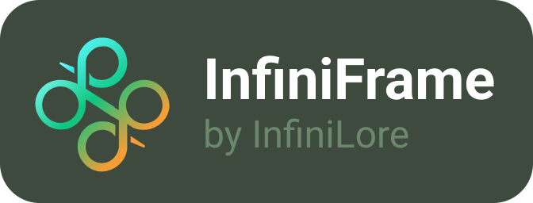

 

*A modern and cross-platform native window framework for .NET that lets you build desktop applications using web
technologies load any URL, render HTML strings, or embed a full Blazor application inside a native window*

Supports **Windows** (WebView2), **Linux** (WebKit2GTK), and **macOS** (WKWebView)

> [!NOTE]
> This project is a modern rework
> of [Photino.Net](https://github.com/tryphotino/photino.NET), [Photino.Net.Server](https://github.com/tryphotino/photino.NET.Server), [Photino.Blazor](https://github.com/tryphotino/Photino.Blazor)
> and [Photino.Native](https://github.com/tryphotino/photino.Native) and is not affiliated with or endorsed by the
> original Photino authors

[](https://github.com/InfiniLore/InfiniFrame/actions/workflows/ci-testing.yml)


## Packages

| Description                                          | Package                                                                                                                                                                                         |
|------------------------------------------------------|-------------------------------------------------------------------------------------------------------------------------------------------------------------------------------------------------|
| Core window builder and runtime                      | [](https://www.nuget.org/packages/InfiniLore.InfiniFrame)                                           |
| Shared interfaces, types, enums, and delegates       | [](https://www.nuget.org/packages/InfiniLore.InfiniFrame.Shared)                      |
| Pre-built Blazor components for custom window chrome | [](https://www.nuget.org/packages/InfiniLore.InfiniFrame.Blazor)                      |
| Full Blazor app integration inside a native window   | [](https://www.nuget.org/packages/InfiniLore.InfiniFrame.BlazorWebView) |
| ASP.NET Core web app running inside a native window  | [](https://www.nuget.org/packages/InfiniLore.InfiniFrame.WebServer)             |
| JavaScript and Blazor interop utilities              | [](https://www.nuget.org/packages/InfiniLore.InfiniFrame.Js)                                  |
| Single-file executable packaging                    | [](https://www.nuget.org/packages/InfiniLore.InfiniFrame.SingleFile)       |

## Quick Start

### Load a URL in a native window

Install: `dotnet add package InfiniLore.InfiniFrame`

```csharp
using InfiniFrame;

var window = InfiniFrameWindowBuilder.Create()
    .SetTitle("My App")
    .SetSize(1280, 720)
    .Center()
    .SetStartUrl("https://example.com")
    .Build();

window.WaitForClose();
```

### Embed a Blazor application

Install: `dotnet add package InfiniLore.InfiniFrame.BlazorWebView`

```csharp
using InfiniFrame.BlazorWebView;

var builder = InfiniFrameApplication.CreateBuilder(args);
builder.UseBlazorWebView(config => {
    config.ConfigureWindow(w => w
        .SetTitle("My Blazor App")
        .SetSize(1280, 720)
        .Center());
    config.RootComponents.Add<App>("#app");
    config.RootComponents.Add<HeadOutlet>("head::after");
});

builder.Build().Run();
```

### BlazorWebView external JS modules (`type="module"` / CDN imports)

When loading external module origins, explicitly trust them via window builder policy:

```csharp
var app = InfiniFrameApplication.CreateBuilder().UseBlazorWebView(config => config.ConfigureWindow(wb => {
    wb.AddTrustedOrigin("https://xyz");
    // add redirects too if needed (e.g. cdn.jsdelivr.net, unpkg.com, etc.)
})).Build();
```

If you must allow every origin (not recommended outside local/dev scenarios):

```csharp
var app = InfiniFrameApplication.CreateBuilder().UseBlazorWebView(config => config.ConfigureWindow(wb => {
    wb.SetTrustAllOrigins(true);
})).Build();
```

### Host an ASP.NET Core web app

Install: `dotnet add package InfiniLore.InfiniFrame.WebServer`

```csharp
using InfiniFrame.Application;
using InfiniFrame.WebServer;

var app = InfiniFrameApplication.CreateBuilder(args)
    .WithWindow("web", static window => window.SetTitle("InfiniFrame"))
    .UseWebServer("web", web => web.ConfigureWebApplication(application =>
        application.MapGet("/", () => "Hello from InfiniFrame")))
    .Build();

app.Run();
```

## Architecture

```
Your Application
│
├── InfiniLore.InfiniFrame                ← Core: window builder & runtime
├── InfiniLore.InfiniFrame.BlazorWebView  ← Blazor app lifecycle
├── InfiniLore.InfiniFrame.WebServer      ← ASP.NET Core integration
│
├── InfiniLore.InfiniFrame.Blazor         ← Window chrome Razor components
├── InfiniLore.InfiniFrame.Js             ← JS/Blazor interop
│
└── InfiniLore.InfiniFrame.Shared         ← Interfaces, types, native interop
        └── InfiniFrame.Native (internal) ← C++ platform layer
```

Only one of `BlazorWebView`, `WebServer`, or the core `InfiniFrame` package is needed for a given application type —
they are independent integration paths

## Examples

| Example                                                     | What it demonstrates                                        |
|-------------------------------------------------------------|-------------------------------------------------------------|
| [BlazorWebView](examples/InfiniFrameExample.BlazorWebView/) | Basic Blazor app in a native window                         |
| [WebApp.Blazor](examples/WebApp/InfiniFrameExample.WebApp.Blazor/) | Blazor Server hosted via ASP.NET Core                       |
| [WebApp.React](examples/WebApp/InfiniFrameExample.WebApp.React/)   | React frontend with custom scheme handler and web messaging |
| [WebApp.Vue](examples/WebApp/InfiniFrameExample.WebApp.Vue/)       | Vue.js frontend with all built-in JS message handlers       |

## Single-File Executable Packing

Use the `InfiniLore.InfiniFrame.SingleFile` package to publish your app as a single executable with embedded native
dependencies. See [`/docs`](docs/docs/guides/pack-tool.md) for full usage details and options

```bash
dotnet add package InfiniLore.InfiniFrame.SingleFile
```

```bash
dotnet publish src/MyApp/MyApp.csproj -t:InfiniFrameSingleFile -r win-x64 -c Release
```

## Documentation

- [Docs Home](https://docs.infiniframe.dev/)
- [Getting Started](https://docs.infiniframe.dev/guides/getting-started) Installation, first app, platform
  requirements

### Guides

- [Core Window](https://docs.infiniframe.dev/guides/core-window) Builder pattern, configuration, events, messaging
- [Trim/AOT Compatibility](https://docs.infiniframe.dev/guides/trim-aot-compatibility) Trimming and NativeAOT
  guarantees and consumer guidance
- [Blazor WebView](https://docs.infiniframe.dev/guides/blazor-webview) Hosting a full Blazor app in a native window
- [Web Server](https://docs.infiniframe.dev/guides/web-server) ASP.NET Core + native window integration
- [Custom Window Chrome](https://docs.infiniframe.dev/guides/custom-window-chrome) Chromeless windows with Blazor
  components
- [JavaScript Interop](https://docs.infiniframe.dev/guides/javascript-interop) Communicating between JS and C#

### API Reference

- [Native C++ API Guide](https://docs.infiniframe.dev/cpp/native-cpp-api)
- [API Reference Hub](https://docs.infiniframe.dev/api)

### Migration

- [Breaking Changes vs Photino.NET](https://docs.infiniframe.dev/migration/photino-breaking-changes) API, namespace,
  event system, and behavioral differences from the original Photino projects

### Build Docs Locally

Requirements:

- `Node.js` 24.15+ and `npm`

Run:

```powershell
npm --prefix docs run dev
```

Build static site:

```powershell
npm --prefix docs run build
```

## Platform Requirements

| Platform | Browser Engine      | Requirement                           |
|----------|---------------------|---------------------------------------|
| Windows  | WebView2 (Chromium) | Windows 10 or later, WebView2 Runtime |
| Linux    | WebKit2GTK          | GTK 3+                                |
| macOS    | WKWebView           | macOS 10.15 Catalina or later         |

## Linux CI Images

Linux GUI tests run in the prebuilt GHCR image published by
`.github/workflows/build-linux-ci-images.yml`. The image is built for x64 and
ARM64 from `.github/ci/linux-image/Dockerfile`; X11 and Wayland startup remains
in `.github/workflows/shared-testing-linux.yml`.

## Repo History

This repo was originally forked from [Photino.NET](https://github.com/tryphotino/photino.NET) and then the history of
the [Photino.Blazor](https://github.com/tryphotino/Photino.Blazor)
and [Photino.Net.Server](https://github.com/tryphotino/photino.NET.Server) repositories were merged into this. By
merging the histories, it was possible to ease further development, especially whilst also preserving the original
commit history and attribution from the contributors of Photino

This was also done for the [Photino.Native](https://github.com/tryphotino/photino.Native) library, but given the
extensive work that had already been done, git was seemingly unable to fully merge the commit history without losing the
original commit history

## License

Unlike the other projects in the InfiniLore ecosystem, this repo follows the same [Apache 2.0 License](LICENSE) as the
original Photino projects
